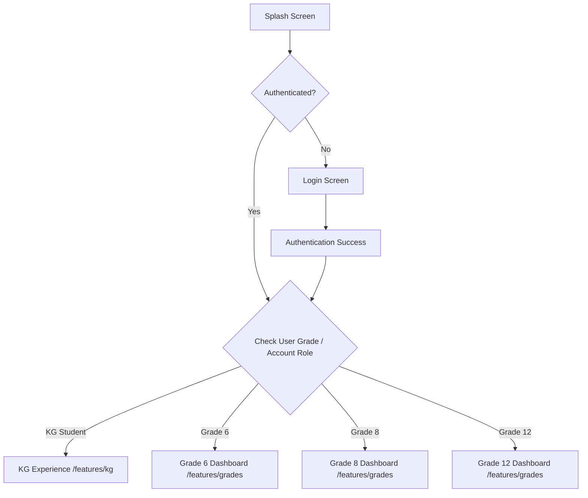

# Architecture Overview - Kuta Learning App

## 1. Architectural Philosophy: Feature-First

This project adopts a **Feature-First** architecture. Rather than grouping code by technical type across the entire project (e.g., global `views/`, `controllers/`, `services/`), code is grouped by business domain and feature context.

```
lib/
├── core/         # Shared infrastructure, themes, utilities, constants, global widgets
└── features/     # Self-contained business domains and learning experiences
```

### Key Principles
- **High Cohesion, Low Coupling**: Every feature owns its presentation (screens, widgets), domain models, and data handling (services).
- **Domain Independence**: Changes to the Kindergarten (KG) experience cannot unintentionally break or regress the Grade 6/8/12 modules.
- **Shared Code Promotion**: Components shared only within a specific feature group live in `features/<feature>/shared/`. Only components genuinely shared globally across the entire app live in `core/`.

---

## 2. Directory Layout

### `lib/core/`
Contains foundational code and utilities shared across the entire application:
- `constants/`: Global constants (`app_constants.dart`, `api_endpoints.dart`, `asset_constants.dart`, `grade_level.dart`).
- `theme/`: Design tokens, colors (`app_colors.dart`), typography (`app_typography.dart`), and themes (`app_theme.dart`).
- `router/`: Central navigation logic (`app_router.dart`, `route_names.dart`).
- `storage/`: Local cache and persistent storage abstraction (`local_storage.dart`).
- `widgets/`: Universal reusable UI components (`app_button.dart`, `app_text_field.dart`, `app_loading_indicator.dart`).
- `utils/`: Helpers, input validators (`validators.dart`), formatters (`formatters.dart`).
- `localization/`: Multi-language and localization setup (`app_localization.dart`).

### `lib/features/`
Contains distinct application features:

#### 1. `authentication/`
- Unified entry point for all users (KG, Grade 6, Grade 8, Grade 12).
- Contains splash screen, login screen, auth models, and routing logic based on user grade/role.

#### 2. `common/`
- Shared learning domain logic (e.g., cross-grade progress tracking, gamification points, common learning models).

#### 3. `kg/` (Kindergarten)
- **Completely isolated** from grades 6, 8, and 12.
- Tailored for young learners: audio-first prompts, playful visual elements, tactile cards, simplified interactions.
- Has its own dedicated screens, widgets, models, and audio/interaction services.

#### 4. `grades/` (Grades 6, 8, and 12)
- Built on a **shared grade structure** (`features/grades/shared/`) because Grades 6, 8, and 12 share the same core Figma design system and learning flow (subject lists, chapters, notes, quizzes, exam preparations).
- Includes dedicated subfolders (`grade_6/`, `grade_8/`, `grade_12/`) for grade-specific specializations (e.g., national exam prep in Grade 12, ministry exams in Grade 8) without duplicating the common layout and logic.

#### 5. `profile/`
- User profile, settings, account details, and study preferences.

---

## 3. High-Level Navigation & User Flow


